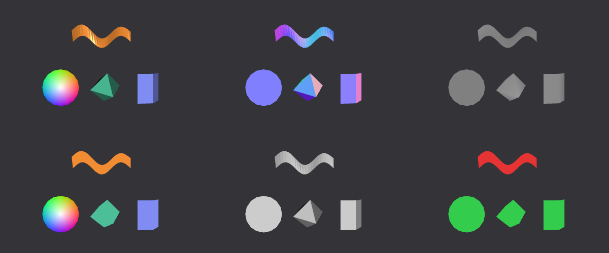

# x3d.wgpu

A small, readable **Rust + wgpu** renderer for X3D scenes. On Linux it runs on
**Vulkan**; the same code runs on Metal (macOS) and DX12/Vulkan (Windows).
It is built to be *tinkered with*: a learning project for low-level graphics
and idiomatic Rust that can grow with you. Start with [LEARNING.md](LEARNING.md).


```sh
cargo run --release -- view scenes/05_still_life.x3d     # interactive window
cargo run --release -- render scenes/06_terrain.x3d -o terrain.png
cargo run --release -- info scenes/08_what_gets_skipped.x3d
```

`x3d-view` is the workspace's only binary, so `cargo run` finds it. To put it on
your PATH: `cargo install --path crates/x3d-render`.

## What it draws

The **static** part of X3D (XML encoding, `.x3d`, `.xml` and gzipped `.x3dz`), from four
primitives up to **Giza v2.1** from x3d.demo (233k triangles over 7 Inlined files, textured PBR;
see [below](#a-hard-one-giza-v21)):

| Area | Nodes |
|---|---|
| Grouping | Transform, Group, StaticGroup, Switch, **LOD** (per frame, by camera distance), Collision, Anchor, CAD*, X3D 4 `visible` (Billboard approximated) |
| Files | **Inline** (relative urls, nested, cached, cycle-safe; `load='false'` honoured unless `--load-all-inlines`) |
| Geometry | Box, Sphere, Cylinder, Cone, IndexedFaceSet, (Indexed)TriangleSet / FanSet / StripSet, (Indexed)QuadSet, ElevationGrid, IndexedLineSet, LineSet, PointSet |
| Appearance | Material (Blinn-Phong), **PhysicalMaterial (GGX metallic-roughness)**, UnlitMaterial, TwoSidedMaterial (front) |
| Textures | **ImageTexture** (PNG/JPEG, mipmapped, 16× anisotropic) in the X3D 4 slots: base/diffuse, normal (no tangents needed), metallicRoughness, occlusion, emissive; Appearance.texture |
| Texture coordinates | TextureCoordinate (+ `texCoordIndex`), TextureCoordinateGenerator `COORD`, MultiTextureCoordinate (first set), X3D's default bounding-box mapping; TextureTransform, TextureTransform3D, TextureTransformMatrix3D |
| Per-vertex | Coordinate, Color, ColorRGBA, Normal, `creaseAngle`, `ccw`, `solid`, `colorPerVertex`, `normalPerVertex`, index fields |
| Lights | DirectionalLight, PointLight, SpotLight: X3D attenuation, radius, beam, and **scoping** (`global='false'` lights only light their own group); up to 16 |
| Environment | Viewpoint, NavigationInfo `headlight`, Background (zenith colour) |
| Reuse | `DEF`/`USE` anywhere, across Inlines too. Shared geometry is tessellated and uploaded **once**. |

Everything else is **counted, never silently dropped**. `x3d-view info` prints the
loss report (the same idea as x3d.lab's `EXPECTED_LOSS`):

```text
shapes 2  meshes 2  triangles 2220  line segments 0  points 0  lights 0  viewpoints 1
skipped (not supported yet):
      1 × ImageTexture (see the textures quest)
      1 × Inline (see the Inline quest in LEARNING.md)
      1 × Text
approximated:
      1 × Billboard (drawn as a Group, not turned to face the camera)
ignored (animation/interaction: this is a still):
      1 × OrientationInterpolator
      2 × ROUTE
      1 × TimeSensor
```

## Commands

| Command | Does |
|---|---|
| `view FILE [--shader scene.wgsl]` | Window. Edits to the `.x3d` **and** the shader hot-reload on save; a broken shader is rejected (with naga's line-numbered error) and the last good one keeps running. Drop another `.x3d` on the window to open it. |
| `render FILE -o out.png [--sheet]` | Headless PNG. `--sheet` renders all six debug views in a 3 × 2 grid. |
| `info FILE [--shapes]` | Loss report, bounds, viewpoints, per-shape triangle counts. |
| `adapters [--backend vulkan]` | Lists the GPUs wgpu can see. |

Shared options: `--backend auto|vulkan|metal|dx12|gl`, `--size 1920x1080`, `--msaa 1|4`,
`--view lit|normals|depth|base-color|lighting-only|facing|uv`, `--color-mode display|linear`,
`--exposure 1.0`, `--wireframe`, `--headlight true|false`, `--no-cull`, `--segments 48`, `--strict`,
`--load-all-inlines`.

### Viewer controls

```text
mouse  left-drag orbit · right/middle-drag pan · wheel zoom · drop a .x3d file to open it
1-7    view: lit · normals · depth · base colour · lighting only · facing (green front / red back) · uv
Tab    next Viewpoint      F  frame everything    R  reset to the first Viewpoint
W      wireframe           H  headlight on/off    C  colour mode (display ↔ linear)
B      back-face culling   L  lines               P  points
+ / -  exposure (PBR)       S  save screenshot     F5 reload    Esc quit
```


*`render --sheet`: lit · normals · depth · base colour / lighting only · facing · uv (an earlier six-view sheet).*

## A hard one: Giza v2.1

`gobbler-worlds-within` in x3d.demo nests **Giza v2.1** in the Gobbler. It's a real test:

- 7 Inlined files: plateau, terrain, a 160k-triangle Sphinx, temples, the Osiris Shaft, the sky bubble;
- PhysicalMaterials with albedo / normal / ORM maps, terrain UVs generated from positions (`COORD` +
  a column-major `TextureTransformMatrix3D`);
- Khufu inside an `LOD` whose ranges force its mesh level;
- the Osiris Shaft's torches (intensity 30–46) scoped with `global='false'`.

Each of those broke something in the first render, and each fix is now a feature with a test.

The Giza assets are private and aren't in this repo. To render them, put **`giza-tour.x3d`** (shipped
separately; it holds only Viewpoints, the sky placement and two Inlines) next to `giza-nest.x3d` and run:

```sh
x3d-view view giza-tour.x3d --load-all-inlines          # Tab cycles the 5 views
x3d-view render giza-tour.x3d --load-all-inlines --viewpoint 4 -o sphinx.png
```

Four of its Viewpoints are the host page's camera stops (`data/bird/worlds.json`), converted out
of the Gobbler's frame (`GizaWorld`: translation `4.824973 -1.632408 1.001651`, scale `0.000328`);
the fifth frames the Sphinx. `--load-all-inlines` loads the Sphinx mesh, which the host loads by
proximity. The six Khufu splat files it also asks for aren't in the repo, and are reported.

## How it fits together

```text
 .x3d ─▶ x3d-scene ─────────────────────────▶ Scene { draws, lights, viewpoints, background, report }
         roxmltree (zero-copy) → DEF/USE → Inline (nested, cached)          │  each draw: mesh, matrix,
         → Transform stack, LOD tags, light scopes                          │  material + texture paths,
         → tessellate (fan, Newell normals, creaseAngle, texcoords) → weld  │  LOD tags, light scopes
                                                                            ▼
         x3d-render:  Renderer::set_scene ── one vertex/index buffer per unique mesh
                                          ├─ one uniform buffer, a 512-byte slot per draw
                                          └─ TextureCache: decode, mipmap, upload once per file;
                                             one bind group per distinct texture set
                      Renderer::render ──── frame uniform (camera + ≤ 16 lights)
                                          └─ pick LOD levels → opaque draws, then transparent
                                             back-to-front; pipelines cached per
                                             (topology, blend, cull, wireframe)
                              │
               viewer (winit, Vulkan swapchain)   headless (texture → buffer → PNG)
```

- **`crates/x3d-scene`** — no GPU code at all, so it builds and tests anywhere.
  Parsing, Inline, the scene graph walk, tessellation and the loss report. Textures are
  resolved to file paths here; decoding them is the renderer's job.
- **`crates/x3d-render`** — the wgpu renderer, the `x3d-view` binary, the
  hello-triangle example, and pixel-checking GPU tests.
- **`scenes/`** — eight sample scenes, from "four primitives" to "what gets skipped".

### Colour: display vs linear

X_ITE lights classic `Material`s **in display space** (colour values used as-is,
`ρ · i`), which is what x3d.lab measured as the reference. That is the default
here (`--color-mode display`), so pictures should line up with X_ITE. `--color-mode
linear` (key **C**) decodes sRGB colours, lights in linear space, and re-encodes:
smoother falloff, and closer to what a glTF/PBR engine would do.

`PhysicalMaterial` is always lit in linear space with the glTF BRDF (Lambert + GGX,
Smith visibility, Schlick Fresnel), with colours taken as linear and textures decoded
from sRGB. It is calibrated against x3d.lab's X_ITE measurement: baseColor 0.8 under a
DirectionalLight of 0.3 draws **78/255** in both (a GPU test checks it). There is no
environment lighting yet, so bare metals look dark (see the IBL quest). The shader also
copes with sRGB swapchain formats, by handing them linear values.

## Testing

```sh
cargo test --workspace          # 64 tests: unit, integration, property (proptest), doc, GPU pixel tests
cargo clippy --workspace --all-targets -- -D warnings
```

The GPU tests render tiny scenes and check exact pixels: a box under the
headlight is (255, 0, 0); 50 % white over red is (255, 128, 128); display vs
linear lighting of 0.8 grey at 45° gives 144 vs 175; PBR gives X_ITE's 78; a 2 × 2
texture is sampled the right way up. A test parses the WGSL with
**naga** and checks the Rust uniform structs have exactly the shader's byte sizes.

**No GPU?** Install a software Vulkan driver, and everything (window included,
under Xvfb) works on the CPU:

```sh
sudo apt install mesa-vulkan-drivers        # lavapipe / llvmpipe
cargo run -p x3d-render -- adapters --backend vulkan
```

## Requirements

- Rust 1.85+ (edition 2024).
- A GPU with Vulkan, Metal or DX12 — or lavapipe as above.
- Linux windowing needs the usual X11/Wayland libraries (`libxkbcommon-x11`, `libxcursor`, …).

Crates: wgpu 30, winit 0.30, glam 0.34, roxmltree, bytemuck, clap, thiserror/anyhow, image (PNG, JPEG), proptest.
All code is safe Rust (`unsafe_code = "forbid"`).

## Licence

MIT OR Apache-2.0.
