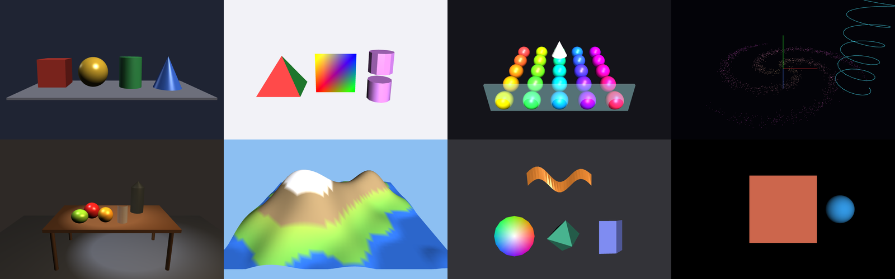
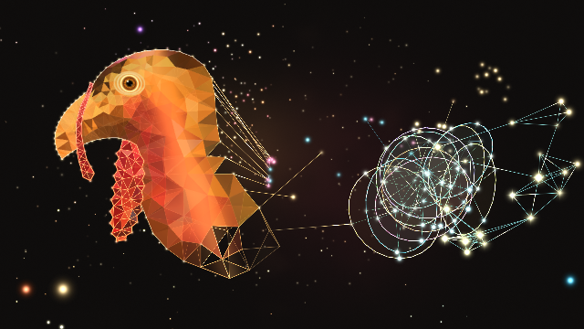
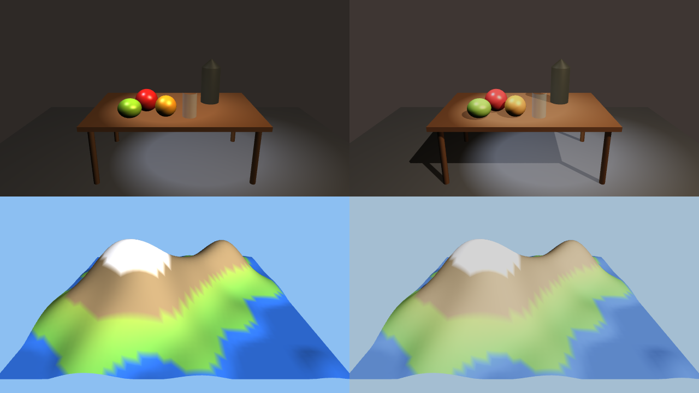
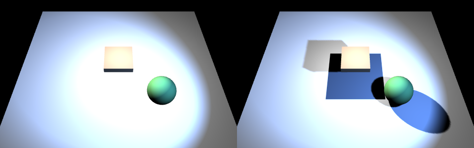

# x3d.wgpu

A small, readable **Rust + wgpu** renderer for X3D scenes. On Linux it runs on
**Vulkan**; the same code runs on Metal (macOS) and DX12/Vulkan (Windows).
It is built to be *tinkered with*: a learning project for low-level graphics
and idiomatic Rust that can grow with you. Start with [LEARNING.md](LEARNING.md).



```sh
cargo run --release -- view scenes/05_still_life.x3d     # interactive window
cargo run --release -- render scenes/06_terrain.x3d -o terrain.png
cargo run --release -- info scenes/08_what_gets_skipped.x3d
```

`x3d-view` is the workspace's only binary, so `cargo run` finds it. To put it on
your PATH: `cargo install --path crates/x3d-render`.

## What it draws

X3D in the XML encoding (`.x3d`, `.xml` and gzipped `.x3dz`), from four primitives up to
**Giza v2.1** from x3d.demo (233k triangles over 7 Inlined files, textured PBR;
see [below](#a-hard-one-giza-v21)) and the **animated, custom-shaded Gobbler 3**
(see [below](#animated-shader-art-gobbler-3)):

| Area | Nodes |
|---|---|
| Grouping | Transform, Group, StaticGroup, Switch, **LOD** (per frame, by camera distance), Collision, Anchor, CAD*, X3D 4 `visible` (Billboard approximated) |
| Files | **Inline** (relative urls, nested, cached, cycle-safe; `load='false'` honoured unless `--load-all-inlines`) |
| Geometry | Box, Sphere, Cylinder, Cone, IndexedFaceSet, (Indexed)TriangleSet / FanSet / StripSet, (Indexed)QuadSet, ElevationGrid, IndexedLineSet, LineSet, PointSet |
| Appearance | Material (Blinn-Phong), **PhysicalMaterial (GGX metallic-roughness)**, UnlitMaterial, TwoSidedMaterial (front) |
| Textures | **ImageTexture** (PNG/JPEG, mipmapped, 16× anisotropic) in the X3D 4 slots: base/diffuse, normal (no tangents needed), metallicRoughness, occlusion, emissive; Appearance.texture |
| Texture coordinates | TextureCoordinate (+ `texCoordIndex`), TextureCoordinateGenerator `COORD`, MultiTextureCoordinate (first set), X3D's default bounding-box mapping; TextureTransform, TextureTransform3D, TextureTransformMatrix3D |
| Per-vertex | Coordinate, Color, ColorRGBA, Normal, `creaseAngle`, `ccw`, `solid`, `colorPerVertex`, `normalPerVertex`, index fields |
| Lights | DirectionalLight, PointLight, SpotLight: X3D attenuation, radius, beam, and **scoping** (`global='false'` lights only light their own group); up to 16 |
| Lines & points | IndexedLineSet, LineSet, PointSet drawn as screen-space quads, so **LineProperties `linewidthScaleFactor`** and **PointProperties** sizes work (and lines behind the camera clip cleanly) |
| Animation | **TimeSensor**, Scalar / Position / Position2D / Color (HSV) / Orientation (slerp) interpolators, Integer & Boolean sequencers, BooleanFilter, BooleanToggle, **ROUTEs** into Transforms, Materials, Lights, Switches, TextureTransforms, shader fields; Viewpoint `bindTime` |
| Shaders | **ComposedShader** with GLSL ShaderParts (X_ITE's GLSL ES 300 dialect, inline CDATA, `data:` or files), translated to Vulkan GLSL and validated by **naga**; `field`s become a uniform block, plus X_ITE's built-ins (`x3d_ModelViewMatrix`, `x3d_Viewport`, …) and point sprites |
| Environment | Viewpoint, NavigationInfo `headlight`, Background (zenith colour) |
| Extras (off by default) | **HDR** with ACES or AgX tone mapping, **bloom**, **sun shadows** from the first DirectionalLight |
| Reuse | `DEF`/`USE` anywhere, across Inlines too. Shared geometry is tessellated and uploaded **once**. |

Everything else is **counted, never silently dropped**. `x3d-view info` prints the
loss report (the same idea as x3d.lab's `EXPECTED_LOSS`):

```text
shapes 2  meshes 2  triangles 2220  line segments 0  points 0  lights 0  viewpoints 1  routes 2
skipped (not supported yet):
      1 × Text
approximated:
      1 × Billboard (drawn as a Group, not turned to face the camera)
warnings:
  - ImageTexture (line 17): no texture file among ["brick.png"]
  - Inline (line 31): no file among ["other_scene.x3d"]
```

## Commands

| Command | Does |
|---|---|
| `view FILE [--shader scene.wgsl]` | Window. Edits to the `.x3d` **and** the shader hot-reload on save; a broken shader is rejected (with naga's line-numbered error) and the last good one keeps running. Drop another `.x3d` on the window to open it. |
| `render FILE -o out.png [--sheet] [--time 8] [--viewpoint 2]` | Headless PNG. `--time` runs the animation to that second first. `--sheet` renders the debug views in a grid. |
| `info FILE [--shapes]` | Loss report, bounds, viewpoints, routes, per-shape triangle counts. |
| `shaders FILE [--show]` | Lists each ComposedShader and whether it compiles; `--show` prints the translated GLSL. |
| `adapters [--backend vulkan] [--budget] [--profile weak]` | Lists the GPUs wgpu can see; `--budget` prints every setting this GPU gets and the limit or feature it came from. |
| `bench FILE [--frames 60] [--cull cpu\|gpu\|off]` | N frames off-screen: GPU ms per pass (shadow, cull, scene, bloom, tone map) from timestamp queries (`null` where unsupported, never a CPU stand-in), CPU ms, culling counts, pipeline-cache effect. |
| `conform [conformance] [--receipt r.json]` | Renders scenes whose expected pixels were measured in X_ITE (Loom record) and validated by x3d_mcp; writes a receipt where every number names its source. |

Shared options: `--backend auto|vulkan|metal|dx12|gl`, `--size 1920x1080`, `--msaa 1|4`,
`--view lit|normals|depth|base-color|lighting-only|facing|uv`, `--color-mode display|linear`,
`--exposure 1.0`, `--wireframe`, `--headlight true|false`, `--no-cull`, `--segments 48`, `--strict`,
`--load-all-inlines`, `--line-scale 1.0`, `--hide-lines`, `--hide-points`,
`--tone-map off|aces|agx`, `--bloom 0.15`, `--bloom-threshold 0.8`, `--shadows`, `--cull off|cpu|gpu`,
`--profile auto|weak` (`weak` emulates a WebGL2-class GPU: downlevel limits, no optional features).

### Viewer controls

```text
mouse  left-drag orbit · right/middle-drag pan · wheel zoom · drop a .x3d file to open it
1-7    view: lit · normals · depth · base colour · lighting only · facing (green front / red back) · uv
Tab    next Viewpoint      F  frame everything    R  reset to the first Viewpoint
W      wireframe           H  headlight on/off    C  colour mode (display ↔ linear)
B      back-face culling   L  lines               P  points
+ / -  exposure             [ / ]  thinner/thicker lines and points    Space  pause/run animation
T      tone map (off · ACES · AgX)   G  bloom (glow)   O  sun shadows
S      save screenshot     F5 reload              Esc quit
```


*`render --sheet`: lit · normals · depth · base colour / lighting only · facing · uv (an earlier six-view sheet).*

## A hard one: Giza v2.1

`gobbler-worlds-within` in x3d.demo nests **Giza v2.1** in the Gobbler. It's a real test:

- 7 Inlined files: plateau, terrain, a 160k-triangle Sphinx, temples, the Osiris Shaft, the sky bubble;
- PhysicalMaterials with albedo / normal / ORM maps, terrain UVs generated from positions (`COORD` +
  a column-major `TextureTransformMatrix3D`);
- Khufu inside an `LOD` whose ranges force its mesh level;
- the Osiris Shaft's torches (intensity 30–46) scoped with `global='false'`.

Each of those broke something in the first render, and each fix is now a feature with a test.

The Giza assets are private and aren't in this repo. To render them, put **`giza-tour.x3d`** (shipped
separately; it holds only Viewpoints, the sky placement and two Inlines) next to `giza-nest.x3d` and run:

```sh
x3d-view view giza-tour.x3d --load-all-inlines          # Tab cycles the 5 views
x3d-view render giza-tour.x3d --load-all-inlines --viewpoint 4 -o sphinx.png
```

Four of its Viewpoints are the host page's camera stops (`data/bird/worlds.json`), converted out
of the Gobbler's frame (`GizaWorld`: translation `4.824973 -1.632408 1.001651`, scale `0.000328`);
the fifth frames the Sphinx. `--load-all-inlines` loads the Sphinx mesh, which the host loads by
proximity. The six Khufu splat files it also asks for aren't in the repo, and are reported.

## Animated shader art: Gobbler 3



`gobbler3-webgpu/v1/gobbler3.x3d` from x3d.demo is the opposite of Giza: few triangles, but
everything moves and almost nothing uses a built-in material. Six **ComposedShaders**
(facets, ribbons, the eye, the sky, star sprites) are written in X_ITE's GLSL ES 300; 60 ROUTEs
drive them; binding the first Viewpoint starts the intro, where a star cloud gathers into the bird.

```sh
x3d-view view gobbler3.x3d                 # Space pauses, Tab walks the 7 Viewpoints
x3d-view render gobbler3.x3d --time 8 --viewpoint 2 -o eye.png
x3d-view shaders gobbler3.x3d --show       # the GLSL 450 that naga actually compiles
```

How the shaders get through (`glsl.rs`, `custom.rs`): loose `uniform`s are gathered into one
`X3DUniforms` block at set 0, varyings get locations matched by name, `gl_PointSize` /
`gl_PointCoord` are rewritten so points become instanced sprites, then naga parses, validates
and *reflects* the result, so the Rust side knows every field's byte offset. A shape is blended
only if X_ITE would blend it: a transparent material, a texture with alpha, or `ColorRGBA`.

Not run yet: TouchSensor and ParticleSystem (counted in `info`).

## Lighting extras



All three are **off by default**, so pictures still match X_ITE.

- **Tone mapping** (`--tone-map aces|agx`, key **T**): the scene renders into a 16-bit float
  target, so nothing clips at 1.0; then `--exposure` scales all light and a curve maps it to the
  screen. ACES is punchy; AgX turns very bright colours toward white instead of shifting their
  hue. On scenes authored for X_ITE (LDR colours) the curve mostly flattens contrast. It's for
  bright PBR and emissive scenes.
- **Bloom** (`--bloom 0.15`, key **G**): light above `--bloom-threshold` is blurred through a
  mip chain (13-tap down, tent up) and added back. Sprites and emissive surfaces glow.
- **Shadows** (`--shadows`, key **O**): lights with X3D 4 `shadows='true'` cast (or, if none
  asks, the first DirectionalLight), darkened by `shadowIntensity`. The sun gets up to 4
  *cascades* fitted texel-stably to slices of the view (no shimmer as the camera moves); a
  SpotLight gets one perspective map, a PointLight six (a cube). 3×3 PCF. Sizes and layer
  counts come from the GPU budget.



## How it fits together

```text
 .x3d ─▶ x3d-scene ─────────────────────────▶ Scene { draws, lights, viewpoints, background, report }
         roxmltree (zero-copy) → DEF/USE → Inline (nested, cached)          │  each draw: mesh, matrix,
         → Transform stack, LOD tags, light scopes                          │  material + texture paths,
         → tessellate (fan, Newell normals, creaseAngle, texcoords) → weld  │  LOD tags, light scopes
                                                                            ▼
         x3d-render:  Renderer::set_scene ── one vertex/index buffer per unique mesh
                                          ├─ one uniform buffer, a 512-byte slot per draw
                                          └─ TextureCache: decode, mipmap, upload once per file;
                                             one bind group per distinct texture set
                      Renderer::render ──── frame uniform (camera + ≤ 16 lights)
                                          └─ pick LOD levels → opaque draws, then transparent
                                             back-to-front; pipelines cached per
                                             (topology, blend, cull, wireframe, shader, hdr)
                      Renderer::update ──── after Scene::advance(t): matrices, materials,
                                             lights, switches and shader fields that changed
                      [shadow pass] → scene pass → [bloom + tone map]
                              │
               viewer (winit, Vulkan swapchain)   headless (texture → buffer → PNG)
```

- **`crates/x3d-scene`** — no GPU code at all, so it builds and tests anywhere.
  Parsing, Inline, the scene graph walk, tessellation and the loss report. Textures are
  resolved to file paths here; decoding them is the renderer's job.
- **`crates/x3d-render`** — the wgpu renderer, the `x3d-view` binary, the
  hello-triangle example, and pixel-checking GPU tests.
- **`scenes/`** — eight sample scenes, from "four primitives" to "what gets skipped".

### Colour: display vs linear

X_ITE lights classic `Material`s **in display space** (colour values used as-is,
`ρ · i`), which is what x3d.lab measured as the reference. That is the default
here (`--color-mode display`), so pictures should line up with X_ITE. `--color-mode
linear` (key **C**) decodes sRGB colours, lights in linear space, and re-encodes:
smoother falloff, and closer to what a glTF/PBR engine would do.

`PhysicalMaterial` is always lit in linear space with the glTF BRDF (Lambert + GGX,
Smith visibility, Schlick Fresnel), with colours taken as linear and textures decoded
from sRGB. It is calibrated against x3d.lab's X_ITE measurement: baseColor 0.8 under a
DirectionalLight of 0.3 draws **78/255** in both (a GPU test checks it). There is no
environment lighting yet, so bare metals look dark (see the IBL quest). The shader also
copes with sRGB swapchain formats, by handing them linear values.

## Testing

```sh
cargo test --workspace          # 109 tests: unit, integration, property, doc, GPU pixel, golden, conformance
X3D_REQUIRE_GPU=1 cargo test --workspace   # what CI runs: no adapter is a failure, not a skip
X3D_BLESS=1 cargo test -p x3d-render --test golden   # re-bless golden images on this adapter
cargo clippy --workspace --all-targets -- -D warnings
```

The GPU tests render tiny scenes and check exact pixels: a box under the
headlight is (255, 0, 0); 50 % white over red is (255, 128, 128); display vs
linear lighting of 0.8 grey at 45° gives 144 vs 175; PBR gives X_ITE's 78; a 2 × 2
texture is sampled the right way up; a 4-pixel LineProperties line is 4 pixels wide; a
ComposedShader paints its field's colour, and a ROUTE into that field repaints it; ACES maps
display 0.5 to 154; bloom spills past an edge; a 45° sun puts a slab's shadow where it belongs.
A test parses the WGSL with
**naga** and checks the Rust uniform structs have exactly the shader's byte sizes.

**Golden images** (`tests/golden/`) diff every sample scene against PNGs blessed on a named
adapter, with a per-adapter tolerance table that says why each row exists. **Conformance**
(`conformance/`) checks pixels against X_ITE measurements and refuses any scene changed since
x3d_mcp validated it. **Fuzzing** (`fuzz/`, cargo-fuzz) hits the loader + animation runtime and
the GLSL → naga path. Every number, with its source: [HARDENING.md](HARDENING.md).

**No GPU?** Install a software Vulkan driver, and everything (window included,
under Xvfb) works on the CPU:

```sh
sudo apt install mesa-vulkan-drivers        # lavapipe / llvmpipe
cargo run -p x3d-render -- adapters --backend vulkan
```

## Requirements

- Rust 1.85+ (edition 2024).
- A GPU with Vulkan, Metal or DX12 — or lavapipe as above.
- Linux windowing needs the usual X11/Wayland libraries (`libxkbcommon-x11`, `libxcursor`, …).

Crates: wgpu 30, naga 30 (GLSL in), winit 0.30, glam 0.34, roxmltree, bytemuck, clap, thiserror/anyhow, image (PNG, JPEG), proptest.
Safe Rust (`unsafe_code = "deny"`), except one audited call in `pipeline_cache.rs`.

## Licence

MIT OR Apache-2.0.
